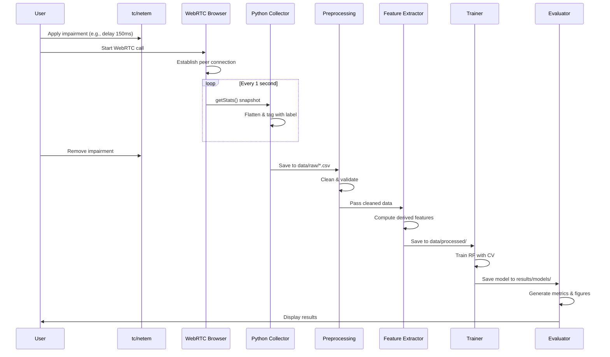

# Tech Stack, Implementation Status & Architecture Details

**Document Version:** 1.0.0  
**Last Updated:** 2026-10-28  
**Project:** WebRTC Multi-Cause Degradation Classification Framework  

---

## 1. Current Implementation Status

As of now, the project has been **scaffolded and structured** according to the research requirements. The implementation is in the **design/template phase** - foundational architecture, documentation, and module skeletons are in place. Actual data collection and model training are pending as they require a live WebRTC testbed and controlled network environment.

### Status Overview

| Component | Status | Notes |
|-----------|--------|-------|
| **Project Structure** | ✅ Complete | Modular layout following research best practices |
| **Documentation (PRD, Architecture, Phases)** | ✅ Complete | Comprehensive specs aligned with IEEE format |
| **Configuration (`src/utils/config.py`)** | ✅ Complete | Centralized paths, seeds, hyperparameters |
| **Collector Module (`src/collector/`)** | 🟡 Template/Skeleton | Structure defined, needs browser automation integration |
| **Preprocessing (`src/preprocessing/`)** | 🟡 Template/Skeleton | Basic functions outlined, needs implementation |
| **Feature Extraction (`src/features/`)** | 🟡 Template/Skeleton | Feature list defined, needs calculation logic |
| **Training (`src/train/`)** | 🟡 Template/Skeleton | Random Forest pipeline outlined |
| **Evaluation (`src/evaluate/`)** | 🟡 Template/Skeleton | Metrics and visualization structure ready |
| **Scripts (netem, experiment runner)** | 🟡 Template/Skeleton | Basic automation scripts created |
| **Data Collection** | ⏳ Pending | Requires WebRTC testbed + `tc/netem` environment |
| **Model Training** | ⏳ Pending | Awaiting collected dataset |
| **Results** | ⏳ Pending | No experimental runs yet |

---

## 2. Tech Stack & Rationale

The stack has been carefully chosen for **reproducibility, lightweight inference, and academic rigor** - aligned with the goal of client-side deployability.

### Core Technologies

| Technology | Version | Purpose | Rationale |
|------------|---------|---------|-----------|
| **Python** | 3.10+ | Primary language | Ecosystem maturity for ML/data science, excellent scientific libraries, easy integration with research workflows. |
| **pandas** | >= 2.0.0 | Data manipulation & analysis | Industry standard for structured telemetry data, efficient CSV/JSON handling, robust DataFrame operations. |
| **NumPy** | >= 1.24.0 | Numerical computing | Foundation for array operations, mathematical computations, and efficient feature calculations. |
| **scikit-learn** | >= 1.3.0 | Machine Learning framework | Provides Random Forest, cross-validation, metrics, preprocessing utilities. Lightweight, interpretable, well-documented, and ideal for real-time inference without GPU requirements. |
| **matplotlib** | >= 3.7.0 | Static visualizations | Publication-quality figures for confusion matrices, ROC curves, feature importance plots. |
| **seaborn** | >= 0.12.0 | Statistical visualization | Enhanced matplotlib with cleaner aesthetics, built-in statistical plots for confusion matrices and distributions. |
| **joblib** | >= 1.3.0 | Model serialization | Efficient pickling for scikit-learn models and preprocessing pipelines, faster than standard pickle for large NumPy arrays. |
| **scipy** | >= 1.11.0 | Scientific computing | Statistical functions, signal processing utilities for jitter/variance calculations. |

### Development & Experimentation Tools

| Tool | Version | Purpose | Rationale |
|------|---------|---------|-----------|
| **Jupyter** | >= 1.0.0 | Interactive exploration | Data analysis, prototyping features, visualizing distributions before finalizing pipeline. |
| **ipykernel** | >= 6.25.0 | Jupyter kernel | Seamless notebook integration with project environment. |
| **PyYAML** | >= 6.0 | Configuration files | Human-readable config for experiments, impairment parameters. |
| **tqdm** | >= 4.65.0 | Progress bars | Better UX for long-running data processing/training loops. |
| **rich** | >= 13.0.0 | Enhanced CLI output | Beautiful, readable logging and experiment progress tracking. |
| **jsonschema** | >= 4.19.0 | Data validation | Validate getStats JSON structure and ensure data integrity. |

### Network & Testing (Future Integration)

| Tool | Purpose | Rationale |
|------|---------|-----------|
| **tc/netem (Linux)** | Network impairment emulation | Industry standard for controlled delay/loss/jitter. Provides reproducible, isolated ground truth as required by literature. |
| **Browser (Chrome/Firefox)** | WebRTC client | Real WebRTC implementation with full `getStats()` API support. |
| **Puppeteer/Playwright** (planned) | Browser automation | Automate peer connections and extract stats programmatically for reproducible experiments. |
| **browsermob-proxy** | >= 0.8.0 | Optional HTTP proxy for traffic manipulation/analysis. |

### Why Random Forest Over Deep Learning?

- **Lightweight Inference**: Tree-based models have minimal computational overhead, critical for real-time client-side deployment
- **Interpretability**: Feature importance reveals which telemetry metrics drive classification - essential for research validation
- **Small Dataset Friendly**: Deep learning needs large datasets; controlled lab experiments yield moderate sample sizes
- **Low Latency**: Inference in milliseconds without GPU dependency
- **Proven Effectiveness**: Literature shows Random Forest/C4.5 outperform on WebRTC QoE tasks with getStats features
- **Reproducibility**: Deterministic with fixed seeds, easier to debug and validate

---

## 3. System Architecture & Component Communication

### 3.1 High-Level Architecture

The framework follows a **pipeline architecture** with clear separation of concerns. Each stage transforms data and passes it to the next component.

```mermaid
graph TB
    subgraph "Test Environment"
        A[WebRTC Peer A]
        B[WebRTC Peer B]
        C[tc/netem Network Link]
    end
    
    subgraph "Data Collection Layer"
        D[getStats() API]
        E[Telemetry Collector]
    end
    
    subgraph "Processing Pipeline"
        F[Raw Data CSV/JSON]
        G[Preprocessing Module]
        H[Feature Extraction]
        I[Processed Dataset]
    end
    
    subgraph "ML Pipeline"
        J[Train/Test Split]
        K[Random Forest Classifier]
        L[Model Artifacts .joblib]
    end
    
    subgraph "Evaluation & Results"
        M[Metrics Calculator]
        N[Visualization Generator]
        O[Results Dashboard/Reports]
    end
    
    A <--> C
    B <--> C
    C --> |Network Impairment| C
    A --> D
    B --> D
    D --> E
    E --> F
    F --> G
    G --> H
    H --> I
    I --> J
    J --> K
    K --> L
    L --> M
    M --> N
    N --> O
```

### 3.2 Component Interaction Details

#### A. Test Environment Layer
- **WebRTC Peers**: Two browser instances establish peer connection via signaling (can be local)
- **tc/netem**: Linux traffic control applies impairments at network interface level
  - **Command**: `tc qdisc add dev <iface> root netem delay/loss/jitter ...`
  - **Effect**: Packets between peers experience controlled latency/loss/jitter
  - **Isolation**: Only one impairment type active per experimental run

#### B. Data Collection Layer
**Communication Flow:**
1. Browser JavaScript calls `peerConnection.getStats()` periodically (every 1 second)
2. Returns RTCStatsReport with objects typed as `inbound-rtp`, `outbound-rtp`, `candidate-pair`, etc.
3. Collector extracts relevant fields (RTT from candidate-pair, jitter/packetsLost from RTP stats)
4. Each snapshot tagged with: `timestamp` (UTC ISO8601), `run_id` (unique per experiment), `label` (from netem condition), `raw` (JSON dump for reproducibility)

**Integration Pattern:**
```python
# Future implementation pattern
stats = await peerConnection.getStats()
record = collect_stats(flatten_stats(stats), label="latency_high", run_id="run_001")
save_to_csv([record], "data/raw/run_001_latency_high.csv")
```

#### C. Processing Pipeline
**Preprocessing (`src/preprocessing/clean.py`):**
- **Input**: Raw CSV/JSON from `data/raw/`
- **Operations**: Drop empty rows, remove duplicates, handle missing values, validate timestamps
- **Output**: Cleaned DataFrame
- **Communication**: Reads via `load_raw_data()`, returns cleaned df to feature extractor

**Feature Extraction (`src/features/extract.py`):**
- **Input**: Cleaned DataFrame
- **Calculations**:
  - `loss_rate = packets_lost / (packets_lost + packets_received)` (with division by zero protection)
  - `frames_dropped_rate = frames_dropped / (frames_dropped + frames_received)`
  - `rtt_delta` = difference between consecutive RTT samples
  - `jitter_variance` = rolling variance of jitter
- **Output**: Feature matrix X with engineered features
- **Communication**: Transforms df in-place/copy, returns augmented DataFrame

#### D. ML Pipeline
**Training (`src/train/train_rf.py`):**
1. **Data Split**: `train_test_split(X, y, test_size=0.2, stratify=y, random_state=42)`
2. **Model Init**: `RandomForestClassifier(n_estimators=100, random_state=42, n_jobs=-1)`
3. **Training**: `clf.fit(X_train, y_train)`
4. **Serialization**: `joblib.dump(clf, 'results/models/rf_model.joblib')`
5. **Communication**: Receives features/labels, returns trained model + test split

**Configuration (`src/utils/config.py`):**
- Central source of truth for all paths and hyperparameters
- All modules import from config to ensure consistency
- `RANDOM_SEED=42` ensures reproducibility across runs

#### E. Evaluation Layer
**Evaluation (`src/evaluate/evaluate.py`):**
1. **Prediction**: `y_pred = clf.predict(X_test)`
2. **Metrics**: `accuracy_score`, `classification_report` (precision/recall/F1 per class)
3. **Visualization**: `confusion_matrix` heatmap saved to `results/figures/`
4. **Communication**: Takes trained model + test data, outputs metrics to console and files

### 3.3 Data Flow Sequence



### 3.4 File System Communication

All components communicate through the filesystem with well-defined interfaces:

| Path | Producer | Consumer | Format | Purpose |
|------|----------|----------|--------|---------|
| `data/raw/*.csv` | Collector | Preprocessing | CSV with timestamp, run_id, label, features | Raw telemetry |
| `data/processed/*.csv` | Preprocessing/Features | Training | CSV with engineered features + label | Clean feature matrix |
| `results/models/*.joblib` | Training | Evaluation/Inference | joblib serialized sklearn objects | Trained models + pipelines |
| `results/figures/*.png` | Evaluation | Documentation | PNG (300 DPI) | Visualizations |
| `results/tables/*.csv` | Evaluation | Documentation/Paper | CSV | Metrics tables |

### 3.5 Configuration Management

All configuration flows through `src/utils/config.py`:
- **Paths**: Dynamically resolved relative to project root using `Path(__file__).resolve().parents[2]`
- **Hyperparameters**: Centralized (RANDOM_SEED, TEST_SIZE, CV_FOLDS, N_ESTIMATORS)
- **Classes**: Defined list ensures consistent labeling across pipeline
- **Auto-creation**: Directories created on import to prevent FileNotFoundError

---

## 4. Implementation Plan & Next Steps

### Immediate (Ready to Implement)
1. **Complete Collector**: Integrate with Puppeteer/Playwright to automate browser and extract getStats
2. **Enhance Preprocessing**: Add robust JSON flattening for RTCStatsReport structure
3. **Implement Feature Extraction**: Calculate all derived features with proper handling
4. **Build Training Pipeline**: End-to-end script connecting all modules
5. **Complete Evaluation**: Add ROC curves, feature importance plots

### Medium Term
1. **Create Test Page**: Simple HTML/JS page with WebRTC peer connection for data collection
2. **Automate Experiments**: Orchestrate netem + collection + processing
3. **Cross-Validation**: Implement stratified k-fold as configured
4. **Hyperparameter Tuning**: GridSearchCV for optimal Random Forest params

### Long Term
1. **Real-time Inference Module**: Lightweight predictor for live use
2. **Extended Features**: Add temporal features (rolling windows, trends)
3. **Additional Models**: Compare with SVM/XGBoost for completeness
4. **Paper Integration**: Update with experimental results

---

## 5. Design Principles

- **Modularity**: Each component is independent and testable
- **Reproducibility**: Fixed seeds, versioned dependencies, documented parameters
- **Simplicity**: Template-based design, easy to extend
- **Scientific Rigor**: Isolated impairments, proper train/test split, comprehensive metrics
- **Efficiency**: Lightweight models suitable for real-time deployment
- **Documentation-Driven**: All changes reflected in docs

---

**Note:** This is a research project scaffold. Full implementation requires a Linux environment with `tc/netem` support and a WebRTC testbed. The architecture is production-ready in design and follows industry best practices for ML pipelines.
